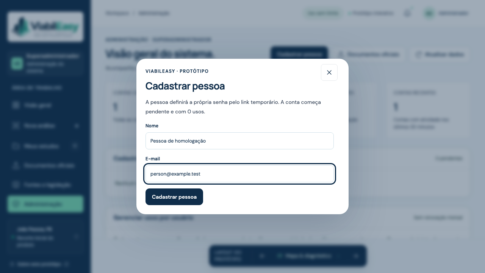
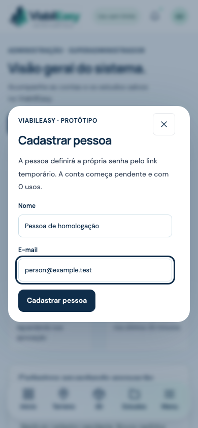

# Homologação do cadastro administrado

CPTECH-2, em 05/11/2026. Execução local com contas sintéticas e bancos descartáveis.

## Resultado

- 96 testes passaram nas suítes Python, migrações SQL e jornada web com serviços reais. Cinco variações foram ignoradas por incompatibilidade com o backend parametrizado. Os cenários correspondentes de produção, migração e backup foram exercitados em sua parametrização aplicável.
- 62 testes de frontend passaram.
- 144 verificações geométricas e de limites passaram.
- Ruff, verificação de formatação, sintaxe JavaScript, build público e compilação do Worker pelo Wrangler 4.155.0 passaram.
- A suíte emitiu o aviso de depreciação já existente do TestClient da Starlette com httpx. A validação da imagem Linux fica no CI do repositório.

## Jornada web exercitada

Chromium com sessões separadas para o administrador e a pessoa cadastrada, usando o handler das Pages Functions, Supabase Auth/GoTrue v2.197.0, PostgREST 16.5 e PostgreSQL 17 locais.

1. Administrador entra e cadastra nome e e-mail pelo formulário.
2. Conta aparece pendente, com saldo zero e senha pendente. O painel exibe o link privado para cópia.
3. A pessoa abre o link, a URL perde o token e o formulário recebe a senha individual.
4. O banco registra credencial definida, aprovação pendente, saldo zero e ausência de verificação independente de e-mail.
5. A pessoa entra e vê a pendência de aprovação.
6. Administrador aprova e concede exatamente um uso pelo painel.
7. A pessoa entra e salva a análise pela função `ViabilAuth.saveStudy`, usada pela aplicação. Reenviar o mesmo estudo mantém saldo zero e consumo total igual a um.
8. O usuário comum recebe 403 ao consultar a administração.
9. O administrador bloqueia a conta e a sessão já aberta perde acesso aos estudos.

O teste verifica rótulos de campos, estados de retorno, remoção do token da URL, ausência de erros JavaScript e dimensões do diálogo em 390 × 844. As capturas registram somente dados sintéticos do formulário, antes da emissão do link.

## Regressões exercitadas

As suítes validam duplicidade de e-mail e chave, autorização administrativa no servidor, ausência de promoção por payload, estado de e-mail separado, aprovação idempotente, concessão idempotente, reemissão, expiração, uso único concorrente de link, bloqueio de sessões, recuperação após falha do provedor, isolamento de estudos e PDFs e duas análises concorrentes com um crédito.

Uma falha injetada na persistência após o débito confirma rollback de saldo, livro de consumo e estudo em SQLite e PostgreSQL/Python, além do dispatcher SQL do Supabase. A repetição após remover a falha consome exatamente um uso.

## Reprodução e publicação

O procedimento de reprodução, as variáveis para os serviços descartáveis, a migração e o plano de publicação e retorno estão em [administracao-contas.md](../administracao-contas.md). A ativação no ambiente hospedado exige aplicar a nova migração e configurar `SUPABASE_SECRET_KEY` como segredo do servidor.
